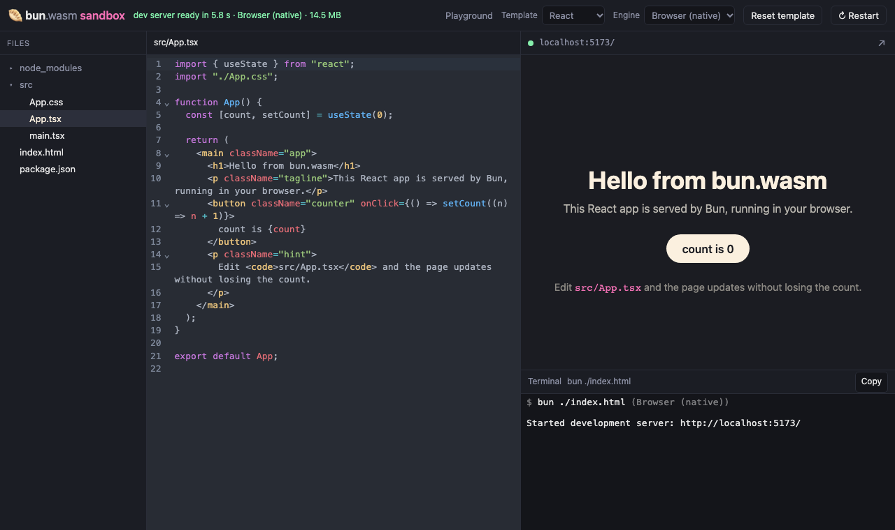
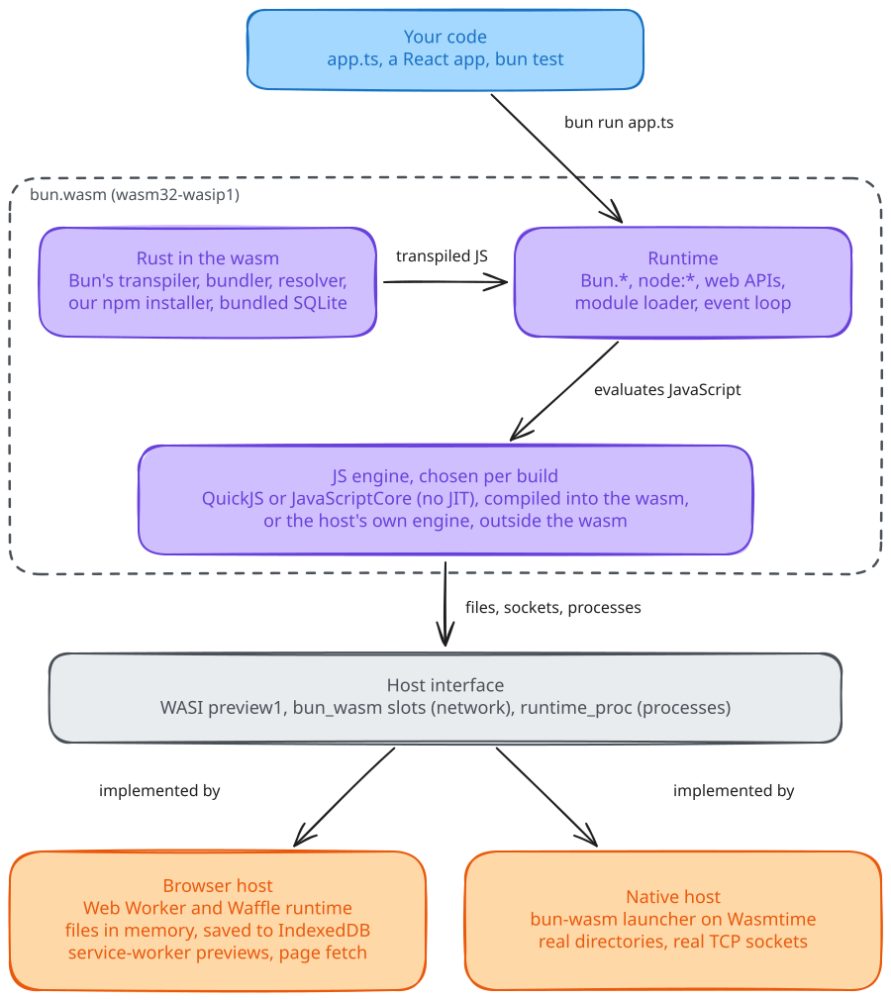

<h1 align="center">bun-wasm</h1>
<p align="center">Bun's Rust toolchain compiled to WebAssembly, with a Bun-compatible runtime: run JS apps, client and server, in a browser tab.</p>
<p align="center"><a href="https://github.com/ShaulLavo/bun-wasm/actions/workflows/ci.yml"></a></p>

```console
user@bun:~$ bun test
(pass) fib > fib(20) = 6765
 5 pass
 0 fail
user@bun:~$ bun build index.ts --outfile out.js
Bundled 1 module in 41ms
user@bun:~$ bun run serve.ts
[preview] https://bun.sprockt.dev/playground/__preview/3000/ (Ctrl-C stops the server)
hello from Bun.serve
```

That is a terminal in a browser tab. The [playground](https://bun.sprockt.dev/playground/) ran every command in the tab, and the [React sandbox](https://bun.sprockt.dev/) bundles and hot-reloads an app the same way. Output is trimmed.



## Why

- **Bun's own toolchain.** The transpiler, bundler, resolver, semver and data parsers are Bun's own Rust crates, built for `wasm32-wasip1` from a pinned oven-sh/bun commit with [13 patches](docs/bun-patches.md).
- **A Bun and Node runtime on three engines.** QuickJS and JavaScriptCore run inside the wasm, and a third guest runs on the page's own JS engine. One runtime, one test fixture suite for all three.
- **Server and client in one tab.** `Bun.serve`, `fetch` and `bun:sqlite` work. A service worker routes preview URLs to the guest's server.
- **Measured, not claimed.** Bun's own test suite: 411 of 2,305 upstream files pass fully on QuickJS (17.8%). Real apps: 9 of 17 projects pass every stage (2026-10-17 snapshot). [Compatibility](docs/compatibility.md) has the method and the failures.

<picture>
  <source media="(prefers-color-scheme: dark)" srcset="docs/assets/architecture.dark.svg">
  
</picture>

The guest is one wasm module. The host, a browser tab or a native Wasmtime launcher, supplies files, network and processes.

## Quick start

Run the playground on your machine. This path uses the published browser guest, so it needs no Rust toolchain. You need git and [Bun](https://bun.sh).

```sh
git clone https://github.com/ShaulLavo/bun-wasm
cd bun-wasm
url=$(bun -e 'import { BUN_WASM_ASSET as a } from "./src/guest-asset.generated.ts"; console.log(a.url)')
curl -fsSL -o /tmp/bun-browser.wasm "$url"
cd web
bun install
BUN_BROWSER_WASM=/tmp/bun-browser.wasm bun run build
bun run preview
```

The last command prints `serving … at http://127.0.0.1:4173/ (cross-origin isolated)`. Open it and press **Run**:

```console
user@bun:~$ bun run 'index.ts'
Hello, world.
Hello, Bun!
Hello, WebAssembly.
Bun version: 1.4.4
```

[Getting started](docs/getting-started.md) walks through the terminal, a server and the sandbox.

## What you can do

| Task | Where |
| --- | --- |
| Try Bun in a tab | [Getting started](docs/getting-started.md) |
| Add Bun to your own page | [Embed bun-wasm in a page](docs/guides/embed-in-a-page.md) |
| Check whether your app runs | [Compatibility](docs/compatibility.md) |
| Find out what a tab cannot do | [Limits](docs/limits.md) |
| Fix a failure | [Troubleshooting](docs/troubleshooting.md) |
| Build the guests and run the tests | [Development](docs/development.md) |

## How it works

Bun's Rust crates and a runtime written in this repo make up the `bun` guest, `wasm32-wasip1`. The runtime implements `Bun.*`, `node:*` and the web APIs on a JavaScript engine behind an `Engine` trait. The host gives the guest files over WASI, sockets through function slots it installs before `_start`, and processes through `runtime_proc` imports. In a browser, each process is a Web Worker and all share one in-memory filesystem saved to IndexedDB. [Architecture](docs/concepts/architecture.md) has the full picture, and the [decision records](docs/adr/001-three-engines-behind-one-runtime.md) say why.

## Docs

[Getting started](docs/getting-started.md) · [Guides](docs/guides/embed-in-a-page.md) · [Concepts](docs/concepts/architecture.md) · [Reference](docs/README.md#look-up) · [Decision records](docs/adr/001-three-engines-behind-one-runtime.md) · [All pages](docs/README.md)

## Status

Pre-1.0 and experimental. The package is `bun-wasm` 0.0.58, marked private, and is not on npm. You install it as a Git dependency. The repository has no tags or releases.

- Memory: each guest is capped at 512 MiB.
- Threads: each guest is single-threaded. Workers are separate guests.
- Network: browsers get `fetch` (with CORS) and servers behind preview URLs. Raw outbound TCP, TLS sockets and Unix sockets do not work.
- No native addons. Nothing starts a native executable in the browser.
- The `browser` engine runs user code in the host glue's global scope. No engine is a security boundary.
- Apps: Vite, SvelteKit, Astro, Vitest, Next.js and Prisma fail at least one stage in the 2026-10-17 snapshot.

| Platform | State |
| --- | --- |
| Chromium, Firefox, WebKit (Playwright) | Covered by the CI browser gates |
| Safari and iOS Simulator | Manual scripts, not in CI |
| Native launcher | Builds on Linux x86_64 in CI |

[Limits](docs/limits.md) has the numbers and their sources.

## License and contributing

The workspace declares `license = "MIT"` in `Cargo.toml`. The repository has no `LICENSE` file yet. Read [Development](docs/development.md) before you change code, and [AGENTS.md](AGENTS.md) if you are an agent. The project takes no GitHub issues.
