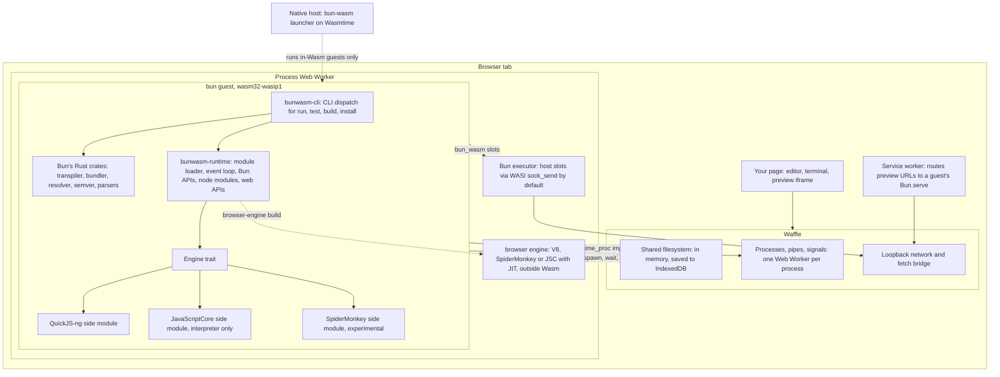
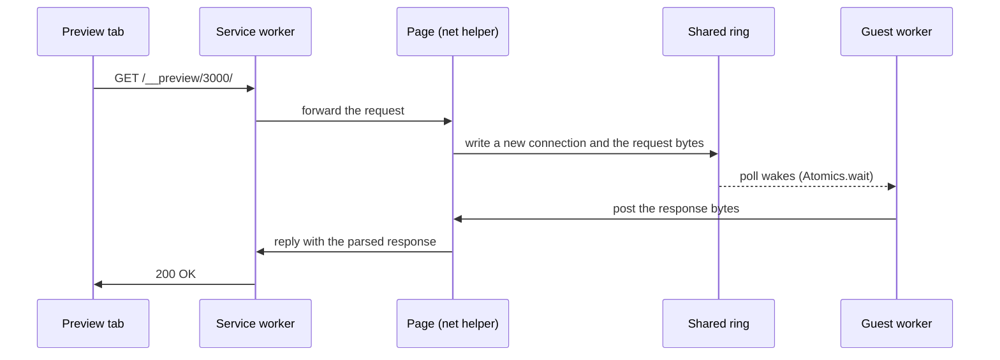

# Architecture

This page explains how a browser tab becomes a Bun host and why the project has the shape it has. For exact signatures, read the reference pages it links to.

The guest box is either one Wasm module for the `browser` engine, or a core module paired with an engine side module for the in-Wasm engines. Everything outside it is the host's job.

## What is Bun's and what is ours

Two kinds of code sit in the guest.

Bun's own Rust crates, including the transpiler, bundler, resolver, `bun_semver`, data parsers and glob, compile to `wasm32-wasip1` from a pinned checkout of `oven-sh/bun`. The pin lives in `scripts/sync-bun.sh`, which rebuilds `vendor/bun` from that commit plus the 28 patches in `patches/bun/` at the v1.4.5 pin. Those patches add `target_os = "wasi"` arms and a few host hooks without rewriting Bun. [Changes to Bun and other upstream source](../bun-patches.md) lists every patch, copied file and adapter.

The runtime is ours. `crates/bunwasm-runtime` implements the module loader, event loop, `Bun.*`, `process`, `node:*` modules and web APIs. It reuses Bun's own JavaScript wherever that code runs without JavaScriptCore internals; [Bun's generated builtins](../bun-builtins.md) supply many `node:*` modules, and Rust natives plus hand-written JavaScript fill the gaps. The runtime also includes a Rust npm installer and a bundled SQLite behind `bun:sqlite`.

That split gives a rule of thumb for bugs. Syntax, bundling and resolution behave like Bun because they are Bun. Everything else behaves like Bun to the degree our runtime matches it, measured in [Compatibility](../compatibility.md).

## One runtime, four engines

The runtime talks to JavaScript through the `Engine` trait in `crates/bunwasm-runtime/src/engine.rs`. Four implementations exist, each with its own guest build. The three in-Wasm engines ship as a Bun core module plus an engine side module that links into the core's memory at load time:

- `quickjs` runs JS on QuickJS-ng inside Wasm, using `bun.wasm` and `quickjs.wasm`.
- `jsc` runs JS on JavaScriptCore without JIT inside Wasm, using `bun-jsc.wasm` and `jsc-engine.wasm`.
- `spidermonkey` runs JS on SpiderMonkey inside Wasm, using `bun-spidermonkey.wasm` and `spidermonkey-engine.wasm`. It is experimental and opt-in, so the package registers it only when requested and the playground labels it experimental. See [SpiderMonkey host integration](../spidermonkey-host-plumbing.md).
- `browser` leaves the JS engine out of Wasm and runs JS on the worker's own engine with JIT, using `bun-browser.wasm`.

All four pass the 2026-11-23 framework matrix; see [Compatibility](../compatibility.md#frameworks-in-the-browser).

Bun's engine is JavaScriptCore, so running Bun's own runtime on it is the obvious first thought. Two facts block that path. JavaScriptCore cannot JIT inside Wasm, so it runs as an interpreter, and Bun's C++ bindings depend on JavaScriptCore internals and assume a 64-bit address space. A spike showed a single-threaded port of the real runtime was feasible but huge, so we started on QuickJS instead. JavaScriptCore runs our runtime through the `Engine` trait as an interpreter and does not use Bun's C++ bindings. See [ADR 001](../adr/001-three-engines-behind-one-runtime.md).

The `browser` engine takes the opposite tradeoff. It leaves the JS engine out of Wasm and runs user code plus the runtime's JavaScript on the engine the worker already has: V8 in Chromium and Node, SpiderMonkey in Firefox, JavaScriptCore with JIT in Safari. The Wasm guest keeps argument parsing, resolution, the transpiler, the bundler, SQLite and the filesystem. It runs with JIT and is the least faithful of the four, because promise state, `AsyncLocalStorage` and import cycles need workarounds; see [The browser engine](../engine-browser.md).

## The host interface

A guest needs three things from its host, each over a different channel for a different reason:

- Files, clocks and stdio come through WASI preview1, because every WASI host provides it.
- Networking comes through `bun_wasm` host slots installed after instantiation, because core Wasm has no optional imports and WASI preview1 has no sockets.
- Processes and signals come through `runtime_proc` imports, because spawn, pipes and waits require a real process model from every host.

Slots work in two modes. The guest exports its function table and a function returning an address in linear memory that holds the ABI version, a slot count, and one entry per host function. Bun's worker executor marks each provided slot to dispatch through WASI `sock_send` imports by default, because iOS Safari rejects cross-module function-table calls at `call_indirect`; hosts can also append functions to the exported table before `_start`. A host that fills no slots still runs the program, and network APIs report "not supported". [ADR 002](../adr/002-host-functions-installed-in-the-function-table.md) explains why the host functions are not plain imports.

`runtime_proc` is the opposite choice. The guest imports `spawn`, `pipe`, `read`, `write`, `wait`, `kill`, `poll` and `signal`. Plain `wasmtime run dist/bun.wasm` fails to link for that reason, so the native launcher exists to provide them for the in-Wasm guests. Processes follow Waffle's generic `ProcessABI`, making a Bun process an ordinary member of the page's process directory beside a shell or any other guest; see [ADR 003](../adr/003-processes-run-on-the-waffle-process-abi.md) and [Host ABI](../host-abi.md).

## A server request in the browser

A browser has no sockets, so `Bun.serve` runs on loopback pipes inside the guest and the page relays requests to it.

The guest worker is blocked inside wasm, so it cannot receive messages. It posts to the page, and the page answers by writing into a `SharedArrayBuffer` ring that the guest's `poll` sleeps on. The page therefore must be cross-origin isolated. [Playground](../playground.md#networking) describes the ring, flow control and the preview route.

## Processes and files

Each process runs in its own worker, so a supervisor in the page stays responsive when a guest blocks. `Bun.spawn`, `node:child_process` and `node:worker_threads` all start more guests this way. In the browser, nothing starts a native executable.

All processes share one live filesystem owned by a single worker. It is Waffle's in-memory filesystem, saved to IndexedDB in the default `fast` mode. A completed write is visible to the editor and to every other process at once, with no copy at spawn and no merge at exit. [Browser storage modes](../storage-modes.md) lists the modes.

The package borrows the page's Waffle `Runtime` and never creates or disposes it ([ADR 004](../adr/004-guests-live-outside-the-package.md) covers where the guest comes from). [Embed bun-wasm in a page](../guides/embed-in-a-page.md) shows the call.

## Where things live

- `crates/bunwasm-cli`: the `bun` binary: argument parsing, and wires the transpiler into the runtime.
- `crates/bunwasm-runtime`: runtime, `Engine` trait, host-engine glue, installer and JS polyfills.
- `crates/bunwasm-engine-quickjs`, `bunwasm-engine-jsc`, `bunwasm-engine-spidermonkey`: engine side modules behind the `Engine` trait.
- `crates/bunwasm-transpiler`, `bunwasm-build`: Bun's transpiler and bundler behind small APIs.
- `crates/bunwasm-jsc`, `bunwasm-spidermonkey`: JavaScriptCore and SpiderMonkey builds and C APIs.
- `crates/bunwasm-host`: native launcher on Wasmtime (`bun-wasm`).
- `crates/bunwasm-tools`: lint and format guest (`bun-tools.wasm`).
- `crates/bunwasm-glue`, `bunwasm-posix`: C and POSIX symbols Bun's crates expect on wasm32.
- `src/`: the `bun-wasm` package: adapter installer and guest loader.
- `web/`: the playground: worker, WASI shim, network bridge and terminal.
- `sandbox/`: multi-framework dev-server sandbox.
- `site/`: deploys the sandbox and playground to bun.shaulavo.dev.
- `patches/bun/`: the patch series for `oven-sh/bun`.
- `tests/`: end-to-end fixtures, run on QuickJS, JSC and the browser engine.
