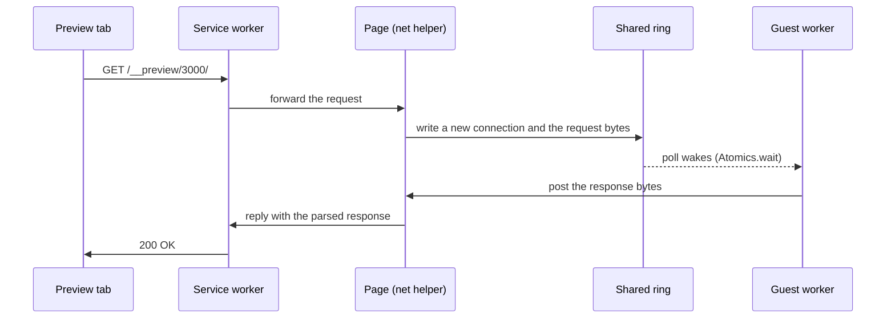

# Architecture

This page explains how a browser tab becomes a Bun host and why the project has the shape it has. For exact signatures, read the reference pages it links to.

<picture>
  <source media="(prefers-color-scheme: dark)" srcset="../assets/architecture.dark.svg">
  
</picture>

The dashed box is one wasm module. Everything below it is the host's job, and there are two hosts. Everything inside it is the same code on both.

## What is Bun's and what is ours

Two kinds of code sit in the guest.

Bun's own Rust crates (the transpiler, the bundler, the resolver, `bun_semver`, the data parsers, glob) compile to `wasm32-wasip1` from a pinned checkout of oven-sh/bun. The pin is the commit in `scripts/sync-bun.sh`, and `scripts/sync-bun.sh` rebuilds `vendor/bun` from it plus the 13 patches in `patches/bun/`. The patches add `target_os = "wasi"` arms and a few host hooks. They do not rewrite Bun. [Changes to Bun and other upstream source](../bun-patches.md) lists each patch, each copied file, and which changes are ports, host features or upstream bugs.

The runtime is ours. `crates/bunwasm-runtime` implements the module loader, the event loop, `Bun.*`, `process`, the `node:*` modules and the web APIs. It prefers Bun's own JavaScript where that code runs without JavaScriptCore: [Bun's generated builtins](../bun-builtins.md) supply many `node:*` modules. Rust natives and hand-written JavaScript fill the gaps. The runtime also holds an npm installer written in Rust and a bundled SQLite behind `bun:sqlite`.

The split gives a rule of thumb for bugs. Syntax, bundling and resolution behave like Bun because they are Bun. Everything else behaves like Bun to the degree the runtime matches it, and [Compatibility](../compatibility.md) measures that degree.

## One runtime, three engines

The runtime talks to a JavaScript engine through the `Engine` trait in `crates/bunwasm-runtime/src/engine.rs`. Three implementations exist, and each builds a separate guest.

| Engine | JS runs on | Guest |
| --- | --- | --- |
| `quickjs` | QuickJS-ng compiled into the wasm | `bun.wasm` |
| `jsc` | JavaScriptCore without JIT, compiled into the wasm | `bun-jsc.wasm` |
| `browser` | The host's own engine | `bun-browser.wasm` |

Bun's engine is JavaScriptCore, so the obvious plan is to run Bun's real runtime on it. Two facts stand in the way. JavaScriptCore cannot JIT inside wasm, so it runs as an interpreter. And Bun's C++ bindings are tied to JavaScriptCore internals and assume a 64-bit machine. A spike found a single-threaded port of the real runtime feasible but large. The runtime started on QuickJS and kept it as the default engine, and JavaScriptCore stays an experiment that shows how far Bun's own engine gets. See [ADR 001](../adr/001-three-engines-behind-one-runtime.md).

The `browser` engine goes the other way. It leaves the engine out of the wasm and runs the runtime's JavaScript on the engine the page already has: V8 in Chromium, JavaScriptCore with JIT in Safari. The guest keeps argument parsing, resolution, the transpiler, the bundler, SQLite and the filesystem. The engine runs with JIT, and it is the least faithful of the three: promise state, `AsyncLocalStorage` and import cycles need workarounds. [The browser engine](../engine-browser.md) lists them.

## The host interface

A guest needs three things from its host. It gets each through a different channel, for a different reason.

| Need | Channel | Why this channel |
| --- | --- | --- |
| Files, clocks, stdio | WASI preview1 | Every WASI host has it. |
| Network | `bun_wasm` slots, installed after instantiation | Core wasm has no optional imports, and WASI preview1 has no sockets. |
| Processes and signals | `runtime_proc` imports | Spawn, pipes and waits need a real process model, so every host must provide them. |

Slots work like this. The guest exports its function table and a function that returns an address in linear memory. At that address sits the ABI version, a slot count and one table index per host function. The host appends its functions to the table, writes their indices into the slots, and then calls `_start`. A host that fills no slots still runs the program, and network APIs report "not supported". [ADR 002](../adr/002-host-functions-installed-in-the-function-table.md) records why imports lost.

`runtime_proc` is the opposite choice. The guest imports `spawn`, `pipe`, `read`, `write`, `wait`, `kill`, `poll` and `signal`. A plain `wasmtime run dist/bun.wasm` fails to link for that reason, and the native launcher exists to provide them. Processes follow Waffle's generic `ProcessABI`, so a Bun process is an ordinary member of the page's process directory, next to a shell or any other guest ([ADR 003](../adr/003-processes-run-on-the-waffle-process-abi.md)). The [Host ABI](../host-abi.md) page has every signature.

## A server request in the browser

A browser has no sockets, so `Bun.serve` runs on loopback pipes inside the guest and the page relays requests to it.

The guest worker is blocked inside wasm, so it cannot receive messages. It posts to the page, and the page answers by writing into a `SharedArrayBuffer` ring that the guest's `poll` sleeps on. The page therefore must be cross-origin isolated. [Playground](../playground.md#networking) describes the ring, flow control and the preview route.

## Processes and files

Each process runs in its own worker, so a supervisor in the page stays responsive when a guest blocks. `Bun.spawn`, `node:child_process` and `node:worker_threads` all start more guests this way. In the browser, nothing starts a native executable.

All processes share one live filesystem owned by a single worker. It is Waffle's in-memory filesystem, saved to IndexedDB in the default `fast` mode. A completed write is visible to the editor and to every other process at once, with no copy at spawn and no merge at exit. [Browser storage modes](../storage-modes.md) lists the modes.

The package borrows the page's Waffle `Runtime` and never creates or disposes it ([ADR 004](../adr/004-guests-live-outside-the-package.md) covers where the guest comes from). [Embed bun-wasm in a page](../guides/embed-in-a-page.md) shows the call.

## Where things live

| Path | Contents |
| --- | --- |
| `crates/bunwasm-cli` | The `bun` binary: argument parsing, wires the transpiler into the runtime |
| `crates/bunwasm-runtime` | Runtime, `Engine` trait, QuickJS and JSC engines, host-engine glue, installer, JS polyfills |
| `crates/bunwasm-transpiler`, `bunwasm-build` | Bun's transpiler and bundler behind small APIs |
| `crates/bunwasm-jsc` | JavaScriptCore build and C API for `engine-jsc` |
| `crates/bunwasm-host` | Native launcher on Wasmtime (`bun-wasm`) |
| `crates/bunwasm-tools` | Lint and format guest (`bun-tools.wasm`) |
| `crates/bunwasm-glue`, `bunwasm-posix` | C and POSIX symbols Bun's crates expect on wasm32 |
| `src/` | The `bun-wasm` package: adapter installer and guest loader |
| `web/` | Playground: worker, WASI shim, network bridge, terminal |
| `sandbox/` | React and vanilla dev-server sandbox |
| `site/` | Deploys the sandbox and playground to bun.sprockt.dev |
| `patches/bun/` | The patch series for oven-sh/bun |
| `tests/` | End-to-end fixtures run on all three engines |
