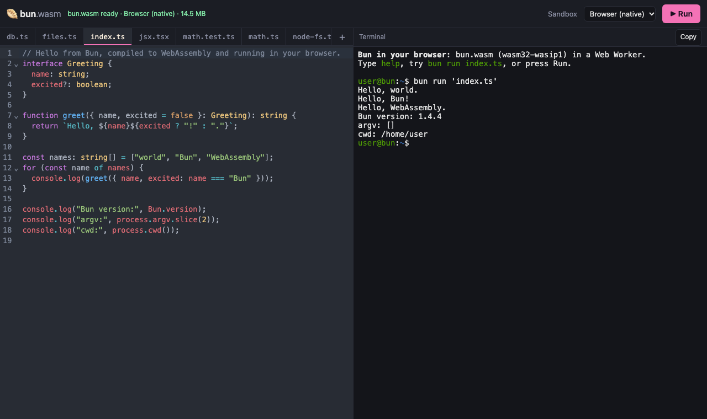

# Getting started

In this tutorial we run, test, bundle and serve TypeScript inside a browser tab, then start the same playground on your own machine. The first half needs Chromium, Firefox or Safari, the browsers the project is tested in. The second half needs git, to clone the repository, and [Bun](https://bun.sh), because the playground's build and preview scripts run on it. We recorded every output below in headless Chromium.

## Open the playground

Open <https://bun.sprockt.dev/playground/>. The header shows `bun.wasm ready` once the guest has loaded. Press **Run**.

The terminal on the right prints the program's output:

```console
user@bun:~$ bun run 'index.ts'
Hello, world.
Hello, Bun!
Hello, WebAssembly.
Bun version: 1.4.4
argv: []
cwd: /home/user
```



Bun's transpiler turned `index.ts` into JavaScript, and the runtime ran it. Nothing left your browser.

## Use the terminal

The terminal runs a small shell. Click it and type each command.

Print the version:

```console
user@bun:~$ bun --version
1.4.4
```

Evaluate an expression:

```console
user@bun:~$ bun -e 'console.log(2 ** 10)'
1024
```

Run the example's tests. The commit hash after the version can differ.

```console
user@bun:~$ bun test
bun test v1.4.4 (d71508d31)
math.test.ts:
(pass) fib > small numbers [1.83ms]
(pass) fib > fib(10) = 55
(pass) fib > fib(20) = 6765
(pass) mean
(pass) mocks and async
 5 pass
 0 fail
 6 expect() calls
Ran 5 tests across 1 file. [28.60ms]
```

Bundle `index.ts` with Bun's bundler and run the result:

```console
user@bun:~$ bun build index.ts --outfile out.js
Bundled 1 module in 41ms
  out.js  362 bytes  (entry point)
user@bun:~$ bun run out.js
Hello, world.
Hello, Bun!
Hello, WebAssembly.
Bun version: 1.4.4
argv: []
cwd: /home/user
```

## Run a server and a client in one tab

Write a file that starts `Bun.serve` and fetches from it. The shell supports `>` and `>>`:

```console
user@bun:~$ echo 'const server = Bun.serve({ port: 3000, fetch: () => new Response("hello from Bun.serve") });' > serve.ts
user@bun:~$ echo 'console.log(await (await fetch("http://localhost:3000")).text());' >> serve.ts
user@bun:~$ echo 'server.stop(); process.exit(0);' >> serve.ts
user@bun:~$ bun run serve.ts
[preview] https://bun.sprockt.dev/playground/__preview/3000/ (Ctrl-C stops the server)
hello from Bun.serve
```

The `[preview]` line is the address of the guest server. A service worker forwards requests for that address to the server inside the worker. Here the program fetches from its own server and then stops it. A server that keeps running stays reachable at the preview link until you press Ctrl-C.

## Query SQLite

The example `db.ts` uses `bun:sqlite`:

```console
user@bun:~$ bun run db.ts
┌───┬────┬─────────────────────────────┬──────┐
│   │ id │ title                       │ done │
├───┼────┼─────────────────────────────┼──────┤
│ 0 │ 1  │ compile Bun to wasm         │ 1    │
│ 1 │ 2  │ run bun:sqlite in a browser │ 1    │
│ 2 │ 3  │ ship it                     │ 0    │
└───┴────┴─────────────────────────────┴──────┘
1 open todo(s); run again and the database file keeps growing
```

## Start a React app

Open <https://bun.sprockt.dev/>. This is the sandbox. It edits a small React app in an in-memory filesystem and runs `bun ./index.html` in a worker. Bun's bundler compiles React in your browser. The status line reads `dev server ready` when the preview is up.


Edit `src/App.tsx`. The page updates without losing the counter, because Bun's own React Fast Refresh runs in the worker.

## Run the playground on your machine

The playground is a static site in `web/`. This path needs no Rust toolchain, because it downloads the published browser guest and checks its SHA-256 against the repository's descriptor. It builds only the `browser` engine.

```sh
git clone https://github.com/ShaulLavo/bun-wasm
cd bun-wasm
url=$(bun -e 'import { BUN_WASM_ASSET as a } from "./src/guest-asset.generated.ts"; console.log(a.url)')
curl -fsSL -o /tmp/bun-browser.wasm "$url"
cd web
bun install
BUN_BROWSER_WASM=/tmp/bun-browser.wasm bun run build
bun run preview
```

The last command prints the address. Open it:

```console
serving /path/to/bun-wasm/web/dist at http://127.0.0.1:4173/ (cross-origin isolated)
```

The page behaves like the hosted playground. The engine picker also lists QuickJS and JSC. They report their guests as missing, because this build did not include them. [Development](development.md) builds all three.

## Where to go next

- [Compatibility](compatibility.md) lists which apps and commands work.
- [Limits](limits.md) lists what a browser tab cannot do.
- [Embed bun-wasm in a page](guides/embed-in-a-page.md) adds Bun to your own app.
- [Architecture](concepts/architecture.md) explains how the pieces fit.
