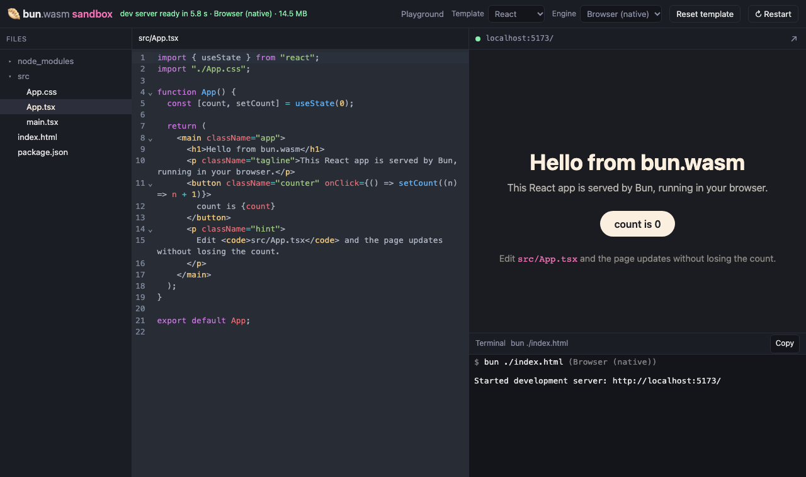
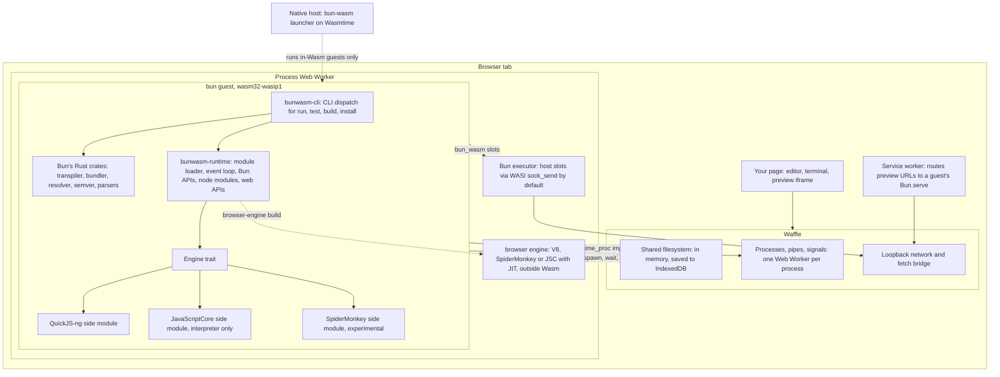

# Project overview

bun-wasm compiles Bun v1.4.5's Rust toolchain to `wasm32-wasip1` and pairs it with a Bun-compatible runtime, so Bun runs inside a browser tab. The in-Wasm guests also run natively under a Wasmtime launcher. Open the [sandbox](https://bun.sprockt.dev/) to install and run real framework starters in your tab, or the [playground](https://bun.sprockt.dev/playground/) for an editor, a terminal with Bun-style colored test and error output, and one-click demos of `Bun.serve`, `bun:sqlite`, `bun test`, `Bun.build`, `Bun.$` and `Bun.file` with a docked server preview.

This project is for playgrounds, tutorials, online editors and browser sandboxes that need Bun and Node code running without a server. It is pre-1.0 and does not replace Bun on your machine.

## What runs

On 2026-11-23, we ran 13 framework starters across four browsers and four JavaScript engines. All 208 combinations passed. Each combination runs `bun install`, starts the dev server, renders the starter page, clicks a counter, edits a source file and waits for the automatic update, runs the production build, serves the built output, and cleans up. Across the 208 cells, the edit step passed with 160 same-document updates across ten frameworks and 48 automatic document replacements across Astro, Angular and Qwik, with no manual reload. The test runner checks document identity and updated text rather than re-reading the counter after the edit.

- Frameworks: Next.js, Nuxt, SvelteKit, Astro, React Router, SolidStart, TanStack Start, Angular, Qwik, Vite with React, Vite with Vue, Vite with Svelte, and Hono.
- Browsers: Chrome and Firefox on Linux, native Safari on macOS, and native iPhone Safari in the iOS 26.5 simulator on macOS. Safari runs use real Safari, not Playwright WebKit.
- Engines: QuickJS, JavaScriptCore, SpiderMonkey, and the browser's own engine.

The guests in the 2026-11-23 run reported Bun 1.4.4. Next.js on desktop Safari with the `browser` engine passed, though Safari's per-tab memory limit still kills that run intermittently on the tested 16 GiB Mac, and no mitigation ships. [Compatibility](compatibility.md) lists the exact revisions, phase rules, historical Bun test-suite results, and unsupported commands.

## How it fits together

The guest binary comes from `crates/bunwasm-cli`. Bun's own Rust crates handle parsing, transpiling, bundling, resolution, semver and data formats. We build them from a pinned `oven-sh/bun` commit, v1.4.5, with 28 small patches that add `target_os = "wasi"` arms and a few host hooks; see [Changes to Bun](bun-patches.md). The runtime in `crates/bunwasm-runtime` is ours. It implements `Bun.*`, `node:*`, the web APIs, `bun:sqlite`, colored terminal output for `bun test` and errors, and an npm installer in Rust, reusing Bun's own `src/js` builtins wherever they run without JavaScriptCore internals.

The runtime talks to JavaScript through the `Engine` trait in `crates/bunwasm-runtime/src/engine.rs`. QuickJS, JavaScriptCore and SpiderMonkey each build as a second Wasm module that links into the core guest's memory at load time. The `browser` engine build leaves the JS engine out of Wasm and runs the runtime's JavaScript on the worker's own engine with JIT. It is the fastest build and the default in browsers, and the least faithful because standard JS engines do not expose promise state or native async-context hooks; see [The browser engine](engine-browser.md).

A guest reaches its host over three paths. WASI preview1 carries files, clocks and stdio. `runtime_proc` imports carry spawn, pipes, waits and signals. Networking goes through `bun_wasm` host slots. In the browser, [Waffle](https://github.com/ShaulLavo/waffle) runs each process in its own Web Worker, shares one live filesystem across every process, and provides the loopback network and fetch bridge. Bun's worker executor installs the host slots and routes them through WASI `sock_send` imports by default, because iOS Safari rejects cross-module function-table calls at `call_indirect`. Because browsers have no listening sockets, `Bun.serve` listens on loopback pipes and a service worker forwards preview URLs to them. [Architecture](concepts/architecture.md) covers each layer and the request path.

## Engines

| Engine | JavaScript runs on | Uncompressed split-profile total |
| --- | --- | ---: |
| `browser`, default in browsers | The worker's host engine with JIT, V8, SpiderMonkey or JavaScriptCore | 15.5 MiB |
| `quickjs` | QuickJS-ng inside Wasm | 18.1 MiB |
| `jsc` | JavaScriptCore inside Wasm, interpreter only | 49.1 MiB at `587c2c69c`, 49.3 MiB at `3b84f36a3` |
| `spidermonkey`, experimental opt-in | SpiderMonkey inside Wasm, interpreter | 27.0 MiB |

These figures are the uncompressed split-profile sizes for core plus engine module, as the playground reported them in Chrome on 2026-11-23. Shared-group profile builds in that same Chrome run measured 19.1 MiB for QuickJS, 48.0 MiB for JSC, and 28.0 MiB for SpiderMonkey. Over the wire with Brotli compression at `3b84f36a3`, the split-profile downloads are 4.6 MiB for `browser`, 5.3 MiB for `quickjs`, 11.9 MiB for `jsc`, and 6.9 MiB for `spidermonkey`.

## Performance

Measured on 2026-11-11 and 2026-11-12, before the November 23 matrix run, on one Linux PC with an Intel Core i7-14700K, 28 logical CPUs and about 32 GB RAM, using headless Chrome 157.0.8103.38 and Playwright Firefox 157.0. Each duration is the median of three interleaved rounds. The machine was not idle, so treat these numbers as rough.

| Workload | Native Node 26.12.1 | Native Bun 1.4.4 | bun-wasm, browser engine, Chrome | bun-wasm, browser engine, Firefox |
| --- | ---: | ---: | ---: | ---: |
| `next build` on the Next.js 15.5.6 starter | 4.78 s | 5.49 s | 20.22 s | 39.39 s |

On the in-Wasm engines, which run without JIT, the same `next build` medians spanned 69.89 s to 103.06 s, with Firefox JSC passing two of three rounds and failing round 3 with `EIO`. For the Vite 8.3.5 React starter, time from dev command submission through render and clicking the counter from 0 to 1 was 2.64 s in Chrome and 4.26 s in Firefox on the `browser` engine, with paired within-round medians of 4.37x to 5.75x the matching native runs.

This benchmark measured total job time only. Native Next loaded its native SWC addon, the `browser` engine guest ran `@next/swc-wasm-nodejs` on the browser's Wasm engine, and the in-Wasm guests ran that nested Wasm through `wasmi`. Because those compiler paths differ, the measurement does not isolate how much of the timing gap comes from any single layer. We have not timed startup on a phone or measured bun-wasm against WebContainers or other in-browser runtimes.

## Status

Pre-1.0. The package is `bun-wasm`, marked private, installed as a Git dependency, and not published on npm. bun-wasm has no tagged releases.

- Each guest caps linear memory at 1 GiB. Shared-group guests share a 2 GiB address space with a 1 GiB cumulative member allowance.
- Each guest is single-threaded. Under the split profile, workers run as separate guests with separate linear memory. Under the shared-group profile, `worker_threads` workers join the parent's Wasm memory group; see [Memory ceiling](memory-ceiling.md).
- In a browser, `fetch` calls the page's `fetch` so CORS applies, and guest servers answer through preview URLs. Outbound raw TCP fails with `ENOTSUP` because browsers expose no raw TCP API. Waffle-backed Unix stream sockets work in the browser through `node:net` and `node:http`, though not in the native Wasmtime launcher. Client TLS works over an available bun-wasm TCP socket, while TLS servers, TLS over Unix sockets, arbitrary `Duplex` wrapping and `tls.rootCertificates` are not supported.
- Native addons do not load, nothing starts a native executable in the browser, and `bun install` skips lifecycle scripts.
- No engine is a security boundary. The `browser` engine runs user code in the host worker's global scope.

[Limits](limits.md) gives each hard limit and where it comes from.

## Docs

[Getting started](getting-started.md) · [Embed in a page](guides/embed-in-a-page.md) · [Architecture](concepts/architecture.md) · [Compatibility](compatibility.md) · [Decision records](adr/001-three-engines-behind-one-runtime.md) · [All pages](README.md)

## License and contributing

[MIT](../LICENSE). Upstream and third-party notices live in `crates/bunwasm-runtime/generated/builtins/LICENSE.md`. Read [Development](development.md) before changing code, and [AGENTS.md](../AGENTS.md) if you are an agent. The project takes no GitHub issues. Report security issues through [SECURITY.md](../SECURITY.md).
