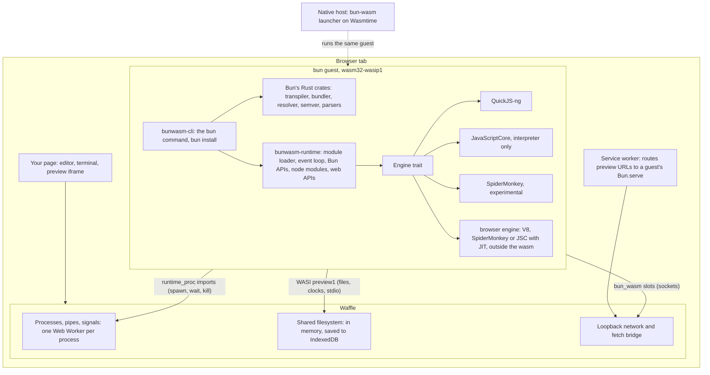

# Project overview

bun-wasm builds Bun's Rust toolchain for `wasm32-wasip1` and wraps it in a Bun-compatible runtime, so Bun runs inside a browser tab. The same guest also runs natively under a Wasmtime launcher. The [sandbox](https://bun.sprockt.dev/) installs and runs real framework projects in the tab, and the [playground](https://bun.sprockt.dev/playground/) gives you an editor and a terminal.

It is for people who build in-browser development tools (playgrounds, tutorials, online editors, sandboxes) and need Bun and Node code to run without a server. It is pre-1.0 and does not replace Bun on your machine.

## What runs

On 2026-11-23 we ran 13 framework starters in four browsers on four engines, 208 combinations, and every one passed. Each combination installs the project with `bun install`, starts the dev server, renders the page, clicks a counter, edits a source file and waits for the hot update, then runs the production build and serves the result.

- Frameworks: Next.js, Nuxt, SvelteKit, Astro, React Router, SolidStart, TanStack Start, Angular, Qwik, Vite with React, Vite with Vue, Vite with Svelte, and a Hono server.
- Browsers: Chrome and Firefox on Linux, Safari on macOS, and iPhone Safari in the iOS simulator. Safari runs are native Safari, not Playwright WebKit.
- Engines: QuickJS, JavaScriptCore, SpiderMonkey, and the browser's own engine.

[Compatibility](compatibility.md) has the method, the one caveat (Next.js on desktop Safari with the browser engine hits intermittent memory-limit failures on a 16 GiB Mac), Bun's own test suite, and the commands that do not run.

## How it fits together

The guest is the `bun` binary from `crates/bunwasm-cli`. Bun's own Rust crates do the parsing, transpiling, bundling and resolution, built from a pinned oven-sh/bun commit (v1.4.5) with 27 small patches that add `target_os = "wasi"` arms and a few host hooks ([Changes to Bun](bun-patches.md)). The runtime in `crates/bunwasm-runtime` is ours: it implements `Bun.*`, `node:*`, the web APIs, `bun:sqlite` and the npm installer, and reuses Bun's own `src/js` modules where they run without JavaScriptCore internals.

The runtime talks to JavaScript through the `Engine` trait (`crates/bunwasm-runtime/src/engine.rs`). QuickJS, JavaScriptCore and SpiderMonkey each compile to a second Wasm module that links into the guest's memory at load time. The `browser` engine leaves the engine out of the wasm and runs the runtime's JavaScript on the page's own engine with JIT. It is the fastest and the default, and the least faithful: promise state and `AsyncLocalStorage` need workarounds ([The browser engine](engine-browser.md)).

The guest reaches its host through three interfaces. WASI preview1 carries files, clocks and stdio. `runtime_proc` imports carry spawn, pipes, waits and signals. Network functions go into `bun_wasm` slots that the host fills in the guest's function table before `_start`. In the browser, [Waffle](https://github.com/ShaulLavo/waffle) implements all three: every process is a Web Worker, all processes share one live filesystem, and `Bun.spawn` starts another guest. A browser has no sockets, so `Bun.serve` listens on loopback pipes, and a service worker turns preview URLs into requests on those pipes. [Architecture](concepts/architecture.md) has the details and the request path.

## Engines

| Engine | JavaScript runs on | Wasm size |
| --- | --- | ---: |
| `browser` (default) | The page's engine: V8, SpiderMonkey or JavaScriptCore, with JIT | 15.5 MiB |
| `quickjs` | QuickJS-ng inside the wasm | 18.1 MiB |
| `jsc` | JavaScriptCore inside the wasm, interpreter only (Bun's own engine) | 49.1 MiB |
| `spidermonkey` | SpiderMonkey inside the wasm, interpreter (experimental, opt-in) | 27.0 MiB |

Sizes are the uncompressed guest plus engine module, as the playground reported them in Chrome during the 2026-11-23 matrix run.

## Performance

Measured on 2026-11-11 and 2026-11-12, before the November 23 matrix run, on one Linux PC (Intel Core i7-14700K, 28 threads, about 32 GB RAM) in headless Chrome 157 and Firefox 157. Each figure is the median of three interleaved rounds. The PC was not idle, so treat these as rough.

| Workload | Native Node 26.12.1 | Native Bun 1.4.4 | bun-wasm, browser engine, Chrome | bun-wasm, browser engine, Firefox |
| --- | ---: | ---: | ---: | ---: |
| `next build` of the Next.js 15.5.6 starter | 4.78 s | 5.49 s | 20.22 s | 39.39 s |

The same `next build` took 70 to 103 seconds on the engines inside the wasm, which run without JIT. For a Vite 8 React app, the time from the dev command to the first working click was 2.64 s in Chrome and 4.26 s in Firefox on the browser engine, 4.4 to 5.8 times the matching native run. Native Next uses its native SWC addon while the guest uses SWC's Wasm build, so part of the gap is the compiler, not bun-wasm.

We have not measured startup on a phone or against other in-browser runtimes.

## Status

Pre-1.0. The package is `bun-wasm`, private, installed as a Git dependency, and not on npm. bun-wasm itself has no tagged releases.

- Each guest has at most 1 GiB of linear memory. Shared-group guests share a 2 GiB address space.
- Each guest is single-threaded. Workers run as separate guests.
- In a browser, `fetch` is the page's `fetch` (CORS applies), and servers are reachable through preview URLs. Raw outbound TCP, TLS sockets and Unix sockets do not work.
- No native addons, and nothing starts a native executable. Lifecycle scripts in `bun install` do not run.
- No engine is a security boundary. The `browser` engine runs user code in the host glue's global scope.

[Limits](limits.md) has the numbers and where each comes from.

## Docs

[Getting started](getting-started.md) · [Embed in a page](guides/embed-in-a-page.md) · [Architecture](concepts/architecture.md) · [Compatibility](compatibility.md) · [Decision records](adr/001-three-engines-behind-one-runtime.md) · [All pages](README.md)

## License and contributing

[MIT](../LICENSE). Upstream and third-party notices are in `crates/bunwasm-runtime/generated/builtins/LICENSE.md`. Read [Development](development.md) before you change code, and [AGENTS.md](../AGENTS.md) if you are an agent. The project takes no GitHub issues. Report security issues through [SECURITY.md](../SECURITY.md).
